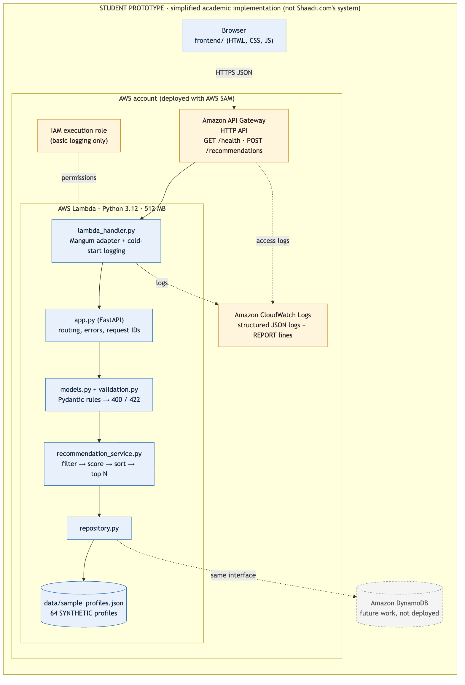
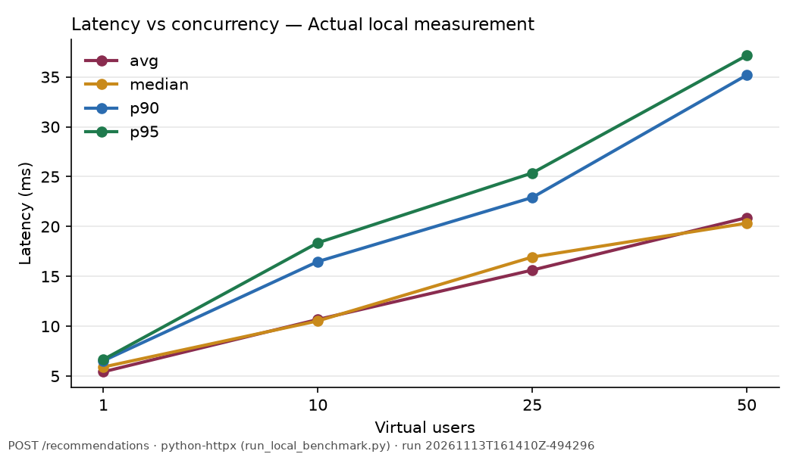

# Serverless Matchmaking Recommendations — a Shaadi.com Cloud Case Study

**Course:** IT457 Cloud Computing · **Case study:** Shaadi.com: AWS, AI/ML, large-scale event processing and serverless computing

| Team member | Role | GitHub |
|---|---|---|
| Bhaumik Luhar (202301468) | Case study, documentation, architecture | @BhaumikLuhar |
| Sheel Shah (202301420) | Backend, API, serverless, infrastructure | @sheelshah |
| Nakul Patel (202301261) | Frontend, experiments, testing, deployment | @thenakulpatel |

> **Live deployment:** _`https://<api-id>.execute-api.<region>.amazonaws.com`_ — **not deployed yet** (see [Deployment](#aws-deployment)).
>
> **New to the repo? Read [START_HERE.md](START_HERE.md) first.**

---

## ⚠️ Disclaimer: real case study vs. student prototype

This repository has **two clearly separate parts**:

| | A. Real-world case study | B. Our student prototype |
|---|---|---|
| What | How Shaadi.com uses AWS, as reported in public sources | A small serverless recommendation API we built |
| Where | [`research/`](research/), [docs/02](docs/02_case_study_analysis.md), [docs/03](docs/03_real_world_architecture.md) | [`backend/`](backend/), [`infrastructure/`](infrastructure/), [`frontend/`](frontend/), [docs/04](docs/04_student_architecture.md) |
| Data | Cited facts, each with a verification status ([sources.md](research/sources.md)) | **Synthetic** profiles only; no real people |
| Algorithm | Not public | A **transparent rules-based score**, not machine learning |

The prototype is **not** Shaadi.com's system and is not affiliated with or endorsed by Shaadi.com.
The course figure *"AI/ML on 67 billion event records → 4 million matches"* originates from Amazon's 2016 Mumbai region launch announcement (Redshift analyzed 67B records for business trends; Shaadi.com helped over 4M people find matches [S1, S7]), which trade press later framed as an AI/ML claim ([sources.md](research/sources.md), claims C1–C2).

## Objective

Build and measure a low-cost, event-driven **serverless API** that shows the cloud ideas behind the case study: on-demand scaling, pay-per-use, managed services, observability and cost per 1,000 requests. The API returns explainable matchmaking recommendations.

## Case-study overview (short)

Shaadi.com is one of the largest online matchmaking services. AWS reported that it had "touched the lives of over 35 million people" (2016). It runs on AWS: EC2, S3 and a Redshift data warehouse [S1]; DynamoDB for messaging, with ≥60% lower cost [S3]; and a serverless, event-driven photo-review pipeline built on Lambda, Step Functions, EventBridge and Rekognition [S4]. Full analysis: [docs/02_case_study_analysis.md](docs/02_case_study_analysis.md).

## Architecture

```
Browser (frontend/) ──HTTPS JSON──► API Gateway HTTP API ──► AWS Lambda (Python 3.12)
                                                              │  lambda_handler.py  (Mangum, cold-start logging)
                                                              │  app.py             (FastAPI routes, errors)
                                                              │  models.py + validation.py (Pydantic → 400/422)
                                                              │  recommendation_service.py (filter → score → sort → top N)
                                                              │  repository.py → data/sample_profiles.json (synthetic)
                                                              └─► CloudWatch Logs (structured JSON)
```

| Diagram | Source | Rendered |
|---|---|---|
| 1. Real-world case-study concept | [case_study_overview.mmd](docs/diagrams/case_study_overview.mmd) | [SVG](docs/diagrams/rendered/case_study_overview.svg) |
| 2. Student cloud architecture | [student_architecture.mmd](docs/diagrams/student_architecture.mmd) | [SVG](docs/diagrams/rendered/student_architecture.svg) |
| 3. API request/response flow | [request_flow.mmd](docs/diagrams/request_flow.mmd) | [SVG](docs/diagrams/rendered/request_flow.svg) |
| 4. Recommendation algorithm | [recommendation_flow.mmd](docs/diagrams/recommendation_flow.mmd) | [SVG](docs/diagrams/rendered/recommendation_flow.svg) |
| 5. AWS deployment architecture | [deployment_architecture.mmd](docs/diagrams/deployment_architecture.mmd) | [SVG](docs/diagrams/rendered/deployment_architecture.svg) |
| 6. Testing & experiment workflow | [testing_workflow.mmd](docs/diagrams/testing_workflow.mmd) | [SVG](docs/diagrams/rendered/testing_workflow.svg) |
| 7. GitHub collaboration workflow | [github_workflow.mmd](docs/diagrams/github_workflow.mmd) | [SVG](docs/diagrams/rendered/github_workflow.svg) |
| 8. Five-week timeline | [project_timeline.mmd](docs/diagrams/project_timeline.mmd) | [SVG](docs/diagrams/rendered/project_timeline.svg) |



## Technology stack

| Layer | Technology |
|---|---|
| Backend | Python 3.12 (tested locally on 3.14; compiles on 3.11), FastAPI, Pydantic v2, Mangum |
| Cloud | AWS Lambda, Amazon API Gateway (HTTP API), Amazon CloudWatch Logs, IAM, AWS SAM |
| Data | Synthetic JSON dataset packaged with the function (DynamoDB-ready repository interface) |
| Frontend | HTML, CSS, vanilla JavaScript (no build step) |
| Testing | pytest, pytest-cov, FastAPI TestClient, ruff, cfn-lint / `sam validate` |
| Load testing | k6 (plus a Python fallback benchmark) |
| Docs | Markdown, Mermaid |

## Local setup

Requires **Python 3.11+** and Git. Node.js is optional (JS syntax checks and diagram rendering).

```bash
git clone https://github.com/<org>/shaadi-cloud-case-study.git
cd shaadi-cloud-case-study
python3 -m venv .venv
source .venv/bin/activate            # Windows: .venv\Scripts\activate
pip install -r requirements.txt

# Start the API (http://localhost:8000; interactive docs at /docs)
uvicorn app:app --app-dir backend/src --reload --port 8000
```

## API documentation

| Method | Path | Purpose | Success | Errors |
|---|---|---|---|---|
| GET | `/health` | Liveness, dataset size, scoring weights | 200 | 503 if data unavailable |
| POST | `/recommendations` | Ranked, explained recommendations | 200 (also when there are no matches) | 400 bad/missing JSON · 422 field errors · 500 unexpected |

**Request fields**

| Field | Type | Rules |
|---|---|---|
| `user_id` | string | 1–20 chars, `A-Z a-z 0-9 _ -` |
| `age` | integer | 18–100 (strict: `"25"` is rejected) |
| `city` | string | 2–50 chars |
| `education` | string | one of `Engineering, Medicine, Science, Commerce, Management, Arts, Law` |
| `interests` | string[] | 1–10 items, no duplicates (case-insensitive), ≤30 chars each |
| `preferences.min_age` / `max_age` | integer | 18–100, `min_age ≤ max_age` (defaults 18 / 100) |
| `preferences.preferred_city` | string? | optional |
| `preferences.preferred_education` | string? | optional, same categories as above |
| `preferences.city_required` | bool | if `true`, other cities are filtered out (needs `preferred_city`) |
| `top_n` | integer | 1–20, default 5 |

### Example request

[`backend/events/sample_request.json`](backend/events/sample_request.json)

```bash
curl -s -X POST http://localhost:8000/recommendations \
  -H "Content-Type: application/json" \
  -d @backend/events/sample_request.json
```

```json
{
  "user_id": "U001",
  "age": 25,
  "city": "Ahmedabad",
  "education": "Engineering",
  "interests": ["music", "travel", "technology"],
  "preferences": { "min_age": 23, "max_age": 29, "preferred_city": "Ahmedabad" },
  "top_n": 3
}
```

### Example response (actual output; first item shown, `request_id` varies)

```json
{
  "status": "success",
  "user_id": "U001",
  "total_candidates": 64,
  "candidates_after_filters": 32,
  "recommendations": [
    {
      "candidate_id": "U161",
      "compatibility_score": 97,
      "age": 26,
      "city": "Ahmedabad",
      "education": "Engineering",
      "common_interests": ["music", "technology", "travel"],
      "reasons": [
        "Similar age (1 year apart)",
        "Matches location preference (Ahmedabad)",
        "Same education background (Engineering)",
        "Similar interests: music, technology, travel"
      ],
      "score_breakdown": { "age": 27.0, "location": 25.0, "education": 15.0, "interests": 30.0 }
    }
  ],
  "request_id": "3f0c2a9e-demo"
}
```

The full response also contains `U162` (score 80) and `U133` (score 62). A test (`test_readme_example_top_result`) checks that this example stays correct.

### Example error (422)

```json
{
  "status": "error",
  "error": {
    "code": "VALIDATION_ERROR",
    "message": "One or more fields are invalid.",
    "details": [
      { "field": "age", "message": "Input should be greater than or equal to 18", "type": "greater_than_equal" },
      { "field": "interests", "message": "duplicate interests are not allowed: music", "type": "value_error" }
    ]
  },
  "request_id": "…"
}
```

### Scoring (max 100, weights defined in [`recommendation_service.py`](backend/src/recommendation_service.py))

| Component | Points | Rule |
|---|---|---|
| Age | 30 | `30 × max(0, 1 − |age gap| / 10)` |
| Location | 25 | preferred city (or your city if no preference) = 25 · your own city = 10 · else 0 |
| Education | 15 | same category = 15 · same field group (STEM / Business / Humanities) = 8 · else 0 |
| Interests | 30 | `30 × common / min(|yours|, |theirs|)` |

Hard filters: never the requesting user; age within `[min_age, max_age]`; city if `city_required`. Ties are sorted by `candidate_id`.

## Frontend

```bash
# with the API running on :8000, in a second terminal:
python -m http.server 5500 --directory frontend
# open http://localhost:5500
```

The API URL is set in **one place**: [`frontend/config.js`](frontend/config.js). You can also override it for a single visit with `?api=https://<api-id>.execute-api.<region>.amazonaws.com`.
The page has a health indicator, demo profiles (including strict-city and no-match cases), a loading state, score rings, reasons, a score breakdown, round-trip and server time, error details and the raw JSON.

## Testing

```bash
bash scripts/run_tests.sh              # validation + lint + JS syntax + pytest with coverage
# Windows: powershell -ExecutionPolicy Bypass -File scripts\run_tests.ps1
python -m pytest -q                     # tests only
python scripts/validate_project.py      # structure, JSON/YAML, links, secret scan
```

**Actual status (2026-11-13, local):** 110 tests passed, 0 failed, 99% line coverage; ruff clean; `sam validate --lint` passed.
`sam build` needs Python 3.12 on PATH (or Docker) and has not run on the authoring machine. Details: [test_reports/validation_summary.md](test_reports/validation_summary.md).

## Load testing

```bash
# Local: starts the API, runs 1/10/25/50 VUs (k6 if installed, otherwise the Python benchmark), analyses and charts
PYTHON=python DURATION=30 bash experiments/run_local_experiments.sh

# k6 directly (install: https://grafana.com/docs/k6/latest/set-up/install-k6/)
k6 run -e BASE_URL=http://localhost:8000 -e SCENARIO=vu10 -e LABEL=local experiments/k6/load_test.js

# AWS (after deployment)
API_URL=https://<api-id>.execute-api.<region>.amazonaws.com bash experiments/run_aws_experiments.sh
```

## AWS deployment

Prerequisites: an AWS account, the [AWS CLI](https://docs.aws.amazon.com/cli/latest/userguide/getting-started-install.html), the [AWS SAM CLI](https://docs.aws.amazon.com/serverless-application-model/latest/developerguide/install-sam-cli.html), and Python 3.12 (or Docker for `--use-container`).

```bash
aws configure                                    # or: aws configure sso   (never commit credentials)
cd infrastructure
sam validate --lint
sam build                                        # or: sam build --use-container
sam local start-api                              # optional local emulation (needs Docker) → http://localhost:3000
sam deploy --guided                              # first time; afterwards: sam deploy
aws cloudformation describe-stacks --stack-name shaadi-recommendation-dev \
  --query "Stacks[0].Outputs" --output table    # get ApiBaseUrl
sam logs --stack-name shaadi-recommendation-dev --tail
sam delete --stack-name shaadi-recommendation-dev   # clean up when finished
```

Full runbook: [docs/06_deployment_guide.md](docs/06_deployment_guide.md). **Deployment status: not deployed.** No AWS credentials were used while preparing this repository.

## Experiment methodology

- **Latency:** avg, min, median, max, p90 and p95 of `POST /recommendations`, measured on the client.
- **Concurrency:** closed-loop virtual users (1, 10, 25, 50), 30 s each, 1 s think time.
- **Cold starts:** `first_invocation_in_env` in our logs, plus Lambda's `Init Duration` in CloudWatch `REPORT` lines ([queries](experiments/cloudwatch/cold_start_queries.md)).
- **Labels:** every result row is `actual_local`, `actual_aws`, `pending_cloud` or `illustrative`. The scripts refuse to mix labels.

Details: [docs/07_testing_and_experiments.md](docs/07_testing_and_experiments.md).

## Cost estimation methodology

`cost(N) = Lambda requests + Lambda GB-seconds + API Gateway requests + CloudWatch Logs + data transfer`, where `GB-s = N × billed_duration_s × memory_GB`.
No prices are hard-coded. Fill them into [`experiments/configs/cost_inputs.json`](experiments/configs/cost_inputs.json) from the [AWS Pricing Calculator](https://calculator.aws/) and run `python experiments/analysis/cost_model.py`. See [docs/08_cost_analysis.md](docs/08_cost_analysis.md).

## Results and screenshots

**Actual local measurement** (MacBook, arm64, uvicorn with 1 worker, Python benchmark client, 2026-11-13). Not AWS figures:

| VUs | Requests | Errors | Req/s | Avg ms | Median ms | p90 ms | p95 ms | Max ms |
|---:|---:|---:|---:|---:|---:|---:|---:|---:|
| 1 | 30 | 0% | 0.99 | 5.43 | 5.91 | 6.54 | 6.66 | 6.75 |
| 10 | 300 | 0% | 9.85 | 10.68 | 10.53 | 16.48 | 18.37 | 20.85 |
| 25 | 750 | 0% | 24.35 | 15.63 | 16.94 | 22.91 | 25.37 | 42.82 |
| 50 | 1500 | 0% | 48.43 | 20.89 | 20.33 | 35.19 | 37.16 | 45.72 |



| Measurement | Status |
|---|---|
| AWS latency at 1/10/25/50 VUs | ✅ Actual AWS, 2026-11-16: p95 72–92 ms, flat across VUs; 5.5% HTTP 503 at 50 VUs ([cloud_summary.md](experiments/results/cloud_summary.md)) |
| Lambda cold-start Init Duration | ✅ Actual AWS: about 1.1 s Init Duration; 1,723 ms first request vs about 52 ms warm, client side ([doc 07](docs/07_testing_and_experiments.md)) |
| Billed duration → cost per 1,000 requests | ✅ avg billed 12.6 ms → **$0.0025 per 1,000 requests** before Free Tier ([doc 08](docs/08_cost_analysis.md)) |
| Frontend screenshots | ✅ Local and AWS, in [`reports/figures/`](reports/figures/) |

## Repository structure

```text
shaadi-cloud-case-study/
├── README.md · START_HERE.md · TEAM_TASKS.md · CONTRIBUTION_MATRIX.md · GITHUB_WORKFLOW.md
├── LICENSE · .gitignore · requirements.txt · pytest.ini · pyproject.toml
├── research/        week1_summary.md (placeholder) · sources.md · salient_points.md
├── docs/            01–10 documentation · diagrams/*.mmd · diagrams/rendered/*.svg|png
├── backend/
│   ├── src/         app.py · lambda_handler.py · models.py · validation.py · recommendation_service.py
│   │                repository.py · logging_utils.py · requirements.txt · data/sample_profiles.json
│   ├── tests/       conftest.py + 6 test modules (110 tests)
│   ├── events/      API Gateway v2 sample events + sample_request.json
│   └── scripts/     generate_profiles.py (deterministic synthetic data)
├── infrastructure/  template.yaml (SAM) · samconfig.toml · README.md
├── frontend/        index.html · style.css · script.js · config.js
├── experiments/     k6/ · configs/ · results/ · analysis/ · charts/ · cloudwatch/ · run_*.sh · run_local_benchmark.py
├── reports/         report_outline.md · figures/
├── presentation/    presentation_outline.md
├── test_reports/    validation_summary.md
└── scripts/         run_tests.sh · run_tests.ps1 · validate_project.py · generate_diagrams.sh · make_zip.sh
```

Changes from the structure in the original brief: we added `logging_utils.py` (structured logs), `backend/events/` (Lambda test events), `backend/scripts/` (data generator), `frontend/config.js` (single API URL setting), `experiments/run_local_benchmark.py` (k6 fallback), `experiments/analysis/{results_schema,cost_model}.py`, `experiments/cloudwatch/`, and `scripts/make_zip.sh`.

## References

See [research/sources.md](research/sources.md) for the full list with verification status. Key sources:

1. J. Barr, "Hot Startups on AWS – June 2016 – Shaadi.com, Capillary, Mondo," *AWS News Blog*, 2016.
2. V. Shah and S. Shah, "How Shaadi.com reduced costs and improved performance with DynamoDB," *AWS Database Blog*, 2022.
3. N. Sood, "Shaadi.com's approach to transitioning from monolith to microservices," *Shaadi.com Tech blog*, 2022.
4. "How Shaadi.com optimized compute costs using Amazon EBS gp3 volumes," *Shaadi.com Tech blog*, 2021.
5. CXOToday News Desk, "AWS and cloud growth to accelerate," 2018 (source of the 67-billion-events claim).
6. AWS documentation: [Lambda](https://docs.aws.amazon.com/lambda/latest/dg/welcome.html), [Lambda execution environment lifecycle](https://docs.aws.amazon.com/lambda/latest/dg/lambda-runtime-environment.html), [HTTP APIs](https://docs.aws.amazon.com/apigateway/latest/developerguide/http-api.html), [SAM](https://docs.aws.amazon.com/serverless-application-model/).

## License

[MIT](LICENSE). Educational project.
