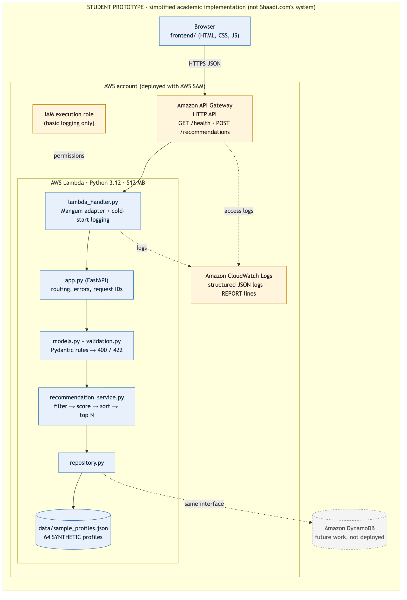

# 4. Student prototype architecture

Diagrams: [student_architecture](diagrams/student_architecture.mmd) · [request_flow](diagrams/request_flow.mmd) · [recommendation_flow](diagrams/recommendation_flow.mmd) · [deployment_architecture](diagrams/deployment_architecture.mmd)

## 4.1 Components

| Layer | Component | File | Responsibility |
|---|---|---|---|
| Client | Static web page | `frontend/index.html`, `script.js`, `config.js` | Collect the profile, call the API, show results, timing and errors |
| Edge | API Gateway **HTTP API** | `infrastructure/template.yaml` | HTTPS endpoint, routes, CORS, throttling (50 rps, burst 100), access logs |
| Compute | AWS Lambda (Python 3.12, 512 MB, 10 s timeout) | `backend/src/lambda_handler.py` | Entry point; Mangum converts API Gateway events into ASGI requests; logs cold starts |
| Application | FastAPI app | `backend/src/app.py` | Routes, request IDs, consistent error format, timing header |
| Validation | Pydantic models | `backend/src/models.py`, `validation.py` | Strict types and ranges; maps errors to 400 or 422 |
| Logic | Recommendation service | `backend/src/recommendation_service.py` | Filter → score → reasons → sort → top N |
| Data | Repository + synthetic JSON | `backend/src/repository.py`, `data/sample_profiles.json` | 64 fictional profiles, loaded once per execution environment |
| Ops | CloudWatch Logs | log groups in the template | JSON logs (7-day retention), Lambda REPORT lines |
| Security | IAM execution role | generated by SAM | `AWSLambdaBasicExecutionRole` only, i.e. write logs |

## 4.2 Key design decisions

| Decision | Alternatives considered | Why we chose it |
|---|---|---|
| **Lambda** (FaaS) | EC2, ECS/Fargate | No servers, scales to zero, pay per request, matches the course exercise |
| **HTTP API** rather than REST API | API Gateway REST API, Lambda Function URL | Simpler and cheaper, with built-in CORS. A Function URL lacks throttling and routing. |
| **FastAPI + Mangum** | Raw handler with manual parsing | One codebase runs locally (uvicorn) and on Lambda; automatic validation and OpenAPI docs |
| **One function, two routes** | One function per route | Smaller cold-start surface and one deployment unit. Fine at this size. |
| **JSON packaged with the code** | DynamoDB, S3 | Zero data cost and no extra IAM. The repository interface keeps DynamoDB a drop-in option. |
| **Rules-based score** | Train an ML model | No real data to train on, and transparency matters for a viva. We say clearly that it is not ML. |
| **x86_64, 512 MB** | arm64 (Graviton), other memory sizes | Safe default. Memory is a template parameter for experiments; arm64 is listed as a cost-saving option. |

## 4.3 Event-driven flow

1. The browser sends `POST /recommendations` with a JSON body.
2. API Gateway matches the route and **invokes Lambda with an event** (payload format 2.0).
3. Lambda reuses a warm execution environment, or creates one (**cold start**: download code, start Python, run module init, load the dataset).
4. Mangum → FastAPI → Pydantic validation. If invalid: **400** (body-level) or **422** (field-level).
5. The service filters candidates (self, age range, optional strict city), scores them, adds reasons, sorts and slices top N.
6. The response goes back through API Gateway with `X-Request-ID` and `X-Response-Time-Ms`.
7. JSON log lines are written to CloudWatch: `http_request`, `recommendations_generated`, `lambda_invocation`.

## 4.4 Scoring algorithm (explainable, not ML)

| Component | Weight | Formula |
|---|---|---|
| Age | 30 | `30 × max(0, 1 − |gap| / 10)` |
| Location | 25 | preferred city (or your city) = 25; your city when you prefer another = 10; else 0 |
| Education | 15 | same = 15; same group (STEM, Business, Humanities) = 8; else 0 |
| Interests | 30 | `30 × |common| / min(|A|, |B|)` (overlap coefficient) |

The score is rounded and clamped to 0–100. Ties are broken by `candidate_id`, so results are deterministic and testable.

## 4.5 Scalability and limits

- Lambda handles concurrency by running **more execution environments**. Each one holds the dataset in memory.
- Account concurrency quota and API throttling (50 rps / burst 100) protect the account from runaway tests.
- Scoring is O(N) over candidates. Fine for 64 profiles. Millions of profiles would need pre-filtering in a database index (DynamoDB GSI or OpenSearch) and precomputed features.

## 4.6 Security

- No credentials in code. Deployment uses the developer's AWS CLI profile.
- Least-privilege role: no read/write access to any other AWS service.
- Strict input validation (`extra="forbid"`, strict ints, length limits) and generic 500 messages (no stack traces).
- CORS origin is a parameter: restrict it to the frontend's URL for anything public.
- No authentication: acceptable for synthetic data, **must** be added (e.g. Cognito JWT authorizer) for real users.

## 4.7 Future improvements

DynamoDB repository · EventBridge events for "interest sent" style actions · Cognito auth · arm64 + memory tuning · provisioned concurrency comparison · caching · CI pipeline (GitHub Actions running `scripts/run_tests.sh`) · an ML ranking model trained on synthetic interaction logs, clearly labelled.
