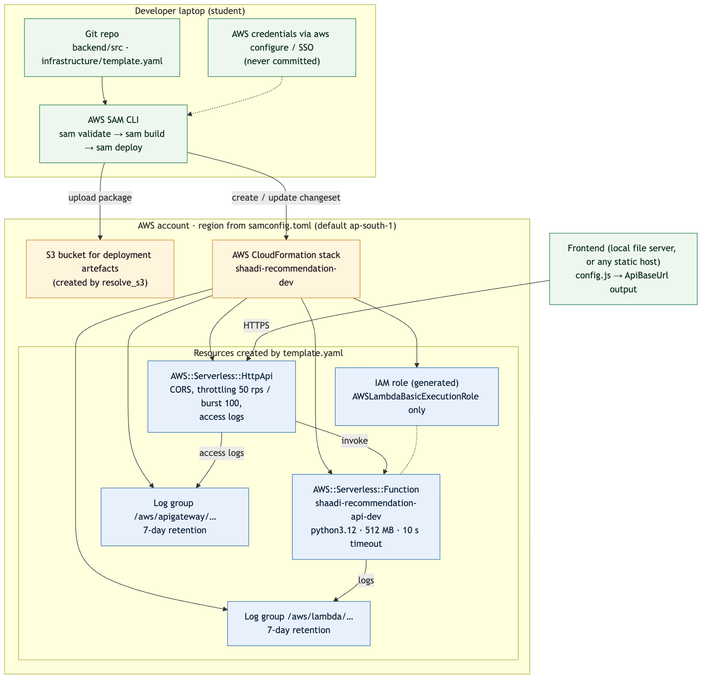

# 6. Deployment and monitoring guide

> Owner: Member 3 (runbook) with Member 2 (template) · Diagram: [deployment_architecture.mmd](diagrams/deployment_architecture.mmd)
> **Status: not yet deployed.** No AWS credentials were used while preparing this repository.



## 6.1 Prerequisites

| Tool | Check | Notes |
|---|---|---|
| AWS account | — | Use a student or sandbox account. Set an **AWS Budgets** alert first. |
| AWS CLI v2 | `aws --version` | https://docs.aws.amazon.com/cli/latest/userguide/getting-started-install.html |
| AWS SAM CLI | `sam --version` | https://docs.aws.amazon.com/serverless-application-model/latest/developerguide/install-sam-cli.html. Optional: `export SAM_CLI_TELEMETRY=0` |
| Python **3.12** | `python3.12 --version` | Must match the Lambda runtime for `sam build`, **or** use Docker with `--use-container` |
| Docker (optional) | `docker info` | Needed for `sam local …` and `--use-container` |
| k6 (experiments) | `k6 version` | https://grafana.com/docs/k6/latest/set-up/install-k6/ |

## 6.2 Credentials (never commit them)

```bash
aws configure            # access key for an IAM user with deploy rights, OR
aws configure sso        # recommended if your organisation uses IAM Identity Center
aws sts get-caller-identity   # confirm which account you are in
```

The deploying identity needs CloudFormation, Lambda, API Gateway, IAM (create role), S3 (artefact bucket) and CloudWatch Logs permissions. The **function's own role** only gets basic logging.

## 6.3 Validate, build, test locally

```bash
cd infrastructure
sam validate --lint
sam build                              # or: sam build --use-container
sam local invoke RecommendationFunction -e ../backend/events/health.json            # needs Docker
sam local invoke RecommendationFunction -e ../backend/events/recommendations.json
sam local start-api                    # http://127.0.0.1:3000/health  (needs Docker)
```

`sam local` runs the function in a Docker container. Its first request is **not** an AWS cold-start measurement.

## 6.4 Deploy

```bash
sam deploy --guided        # first time: accept stack name shaadi-recommendation-dev, region, CAPABILITY_IAM
sam deploy                 # later deploys use samconfig.toml
```

Override parameters as needed:

```bash
sam deploy --parameter-overrides StageName=dev MemorySize=1024 CorsAllowOrigin=http://localhost:5500
```

## 6.5 Get the API URL and smoke test

```bash
aws cloudformation describe-stacks --stack-name shaadi-recommendation-dev \
  --query "Stacks[0].Outputs[?OutputKey=='ApiBaseUrl'].OutputValue" --output text
export API_URL=<paste>
curl -s "$API_URL/health"
curl -s -X POST "$API_URL/recommendations" -H "Content-Type: application/json" -d @../backend/events/sample_request.json
```

Then set `API_BASE_URL` in `frontend/config.js` (or open `index.html?api=$API_URL`).

## 6.6 Monitoring and logs

```bash
sam logs --stack-name shaadi-recommendation-dev --name RecommendationFunction --tail
aws logs tail /aws/lambda/shaadi-recommendation-api-dev --follow
aws logs tail /aws/apigateway/shaadi-recommendation-api-dev --since 15m
```

CloudWatch Logs Insights queries for cold starts, latency and billed duration are in [experiments/cloudwatch/cold_start_queries.md](../experiments/cloudwatch/cold_start_queries.md).
Useful console views: Lambda → Monitor (Invocations, Duration, Errors, Throttles, ConcurrentExecutions); API Gateway → Metrics (Count, Latency, 4xx, 5xx).

## 6.7 Optional: host the frontend

The frontend is three static files. For the demo, `python -m http.server 5500 --directory frontend` is enough. For public hosting, an S3 static website or AWS Amplify Hosting works. If you host it, restrict `CorsAllowOrigin` to that URL. This is not required and is not part of the template, to keep costs at zero.

## 6.8 Clean up (do this after the viva)

```bash
sam delete --stack-name shaadi-recommendation-dev
```

This removes the API, function, role and log groups. Also check that the SAM artefact bucket (`aws-sam-cli-managed-default-*`) holds nothing you need.

## 6.9 Troubleshooting

| Symptom | Likely cause | Fix |
|---|---|---|
| `Binary validation failed for python … python3.12` | Python 3.12 not on PATH | Install 3.12 or `sam build --use-container` |
| Browser shows a CORS error | Wrong `CorsAllowOrigin` | Redeploy with `*` or the exact origin (scheme + host + port) |
| `{"message":"Not Found"}` | Wrong path or method (only 2 routes exist) | Use `GET /health` or `POST /recommendations` |
| HTTP 429 | API throttling (50 rps) | Lower k6 VUs, or raise the limits in the template on purpose |
| 502 / `Internal server error` | Import error in the package | `sam logs …` and look for the traceback in the Init phase |
