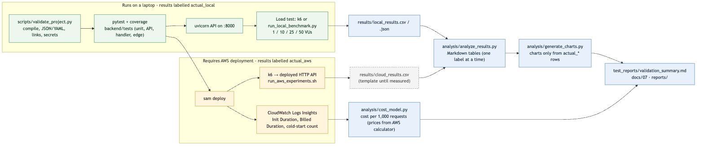
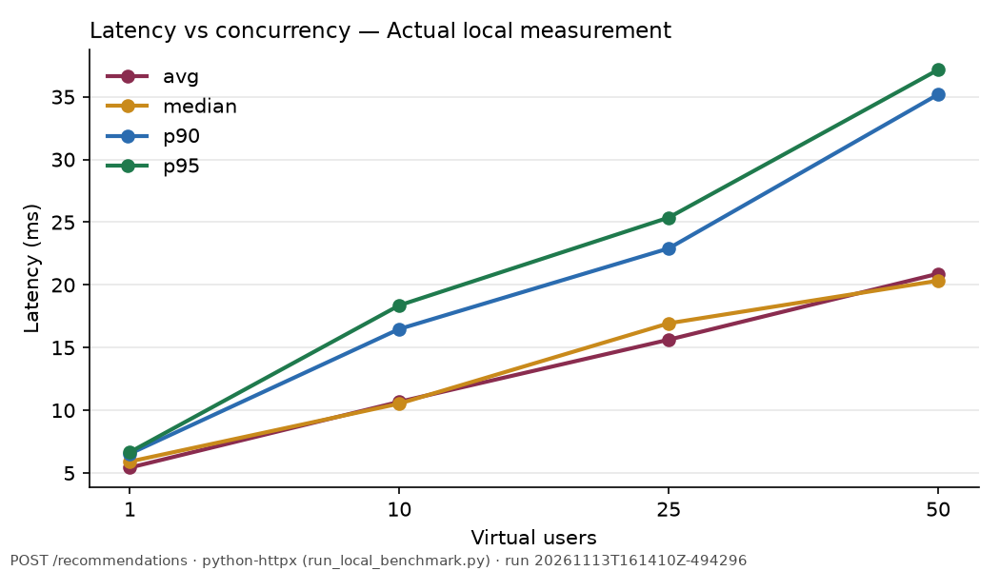
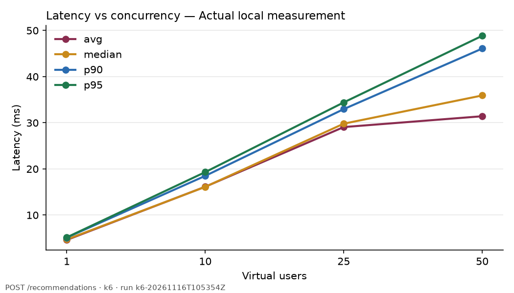

# 7. Testing and experiments

> Owner: Member 3 (experiments) and Member 2 (backend tests) · Diagram: [testing_workflow.mmd](diagrams/testing_workflow.mmd)

## 7.1 Automated tests

Run everything with `bash scripts/run_tests.sh`. The latest actual results are in [test_reports/validation_summary.md](../test_reports/validation_summary.md).

| File | Tests | What it covers |
|---|---:|---|
| `test_models.py` | 14 | Defaults, normalisation, extra fields, dataset validity and uniqueness, repository errors and caching |
| `test_validation.py` | 41 | Missing fields, invalid ages, wrong types (`"25"`, `true`, `25.5`), invalid age ranges, empty and duplicate interests, unknown education, 400-vs-422 classification |
| `test_recommendation.py` | 24 | Weights, score boundaries (0 and 100), each component, self-exclusion, inclusive age filter, strict city, sorting and tie-breaks, top-N, no matches, README example |
| `test_api.py` | 14 | Health, response structure, status codes 200/400/404/405/422, request-ID propagation, CORS preflight |
| `test_handler.py` | 8 | API Gateway v2 events through the real Lambda handler, base64 bodies, first-invocation flag, structured log fields |
| `test_edge_cases.py` | 9 | 500 without leaking details, 503 when data is missing, env-configured data path, unicode, null preferences, oversized bodies |
| **Total** | **110** | 99% line coverage of `backend/src` |

## 7.2 Experiment definitions

| Term | Meaning in this project |
|---|---|
| **Virtual user (VU)** | A simulated client looping *request → wait for response → think 1 s* (closed loop) |
| **Latency** | Client-measured time from sending the request to receiving the full response |
| **p90 / p95** | 90% / 95% of requests finished at or below this time |
| **Throughput** | Completed requests per second over the scenario |

Scenarios (`experiments/configs/scenarios.json`, `experiments/k6/scenarios.js`): **1, 10, 25 and 50 VUs, 30 s each**, endpoint `POST /recommendations`, three rotating synthetic bodies.
With 1 s of think time, the maximum load is about VUs requests/s (≤ 50 rps). That fits within the API throttle and keeps AWS usage tiny.

## 7.3 Result labels (never mixed)

| Label | Meaning | File |
|---|---|---|
| `actual_local` | Measured on our laptop against uvicorn | `experiments/results/local_results.csv` |
| `actual_aws` | Measured against the deployed API | `experiments/results/cloud_results.csv` (created by `collect_results.py`) |
| `pending_cloud` | Placeholder: not yet measured | `experiments/results/cloud_results_template.csv`, `cold_start_template.csv` |
| `illustrative` | Teaching example only | not used in results |

## 7.4 Actual local measurement (2026-11-13)

Environment: MacBook (Darwin arm64), Python 3.14, uvicorn with 1 worker, client `run_local_benchmark.py` (httpx threads, because k6 was not installed on that machine). Run `20261113T161410Z-494296`.

| VUs | Requests | Errors | Req/s | Avg ms | Min ms | Median ms | p90 ms | p95 ms | Max ms |
|---:|---:|---:|---:|---:|---:|---:|---:|---:|---:|
| 1 | 30 | 0% | 0.99 | 5.43 | 1.18 | 5.91 | 6.54 | 6.66 | 6.75 |
| 10 | 300 | 0% | 9.85 | 10.68 | 2.48 | 10.53 | 16.48 | 18.37 | 20.85 |
| 25 | 750 | 0% | 24.35 | 15.63 | 1.47 | 16.94 | 22.91 | 25.37 | 42.82 |
| 50 | 1500 | 0% | 48.43 | 20.89 | 1.62 | 20.33 | 35.19 | 37.16 | 45.72 |

### 7.4b Actual local measurement with k6 (2026-11-16)

Same scenarios and API code, but with **k6 v2.4.0** as the client (the tool we will also use on AWS). Run `k6-20261116T105354Z`, MacBook (Darwin arm64), uvicorn with 1 worker. Raw k6 summaries are in `experiments/results/raw/k6_local_*.json`; the table is in [`local_k6_summary.md`](../experiments/results/local_k6_summary.md).

| VUs | Requests | Errors | Req/s | Avg ms | Min ms | Median ms | p90 ms | p95 ms | Max ms |
|---:|---:|---:|---:|---:|---:|---:|---:|---:|---:|
| 1 | 30 | 0% | 0.99 | 4.62 | 1.87 | 4.72 | 5.13 | 5.17 | 5.51 |
| 10 | 300 | 0% | 9.84 | 16.14 | 9.93 | 16.12 | 18.50 | 19.31 | 25.73 |
| 25 | 750 | 0% | 24.27 | 29.07 | 2.21 | 29.81 | 32.96 | 34.42 | 41.63 |
| 50 | 1468 | 0% | 47.35 | 31.42 | 1.85 | 35.92 | 46.09 | 48.85 | 53.52 |

**Comparison with the Python-client run (7.4):** both runs show 0 errors, throughput matching the offered load, and latency rising with concurrency, because one local process queues the requests. The k6 numbers are higher at 10–50 VUs (p95 at 50 VUs: 48.9 ms vs 37.2 ms). The two runs used different client tools on different days, so this gap reflects differences between tools and between runs, not a change in the API. Use **k6 rows only** when comparing against AWS, so the client tool is the same on both sides.

**How to read it:** a single local process serves every VU, so requests queue up and latency grows with concurrency (median 5.9 → 20.3 ms). Throughput tracks the offered load (about VUs × 1 rps), with no errors. These numbers have **no network hop to AWS and no Lambda**. They show that the application code is fast, and they **must not** be presented as cloud performance.

**Hypothesis for AWS (to test, not a result):** latency will include tens of milliseconds of network time to the region, plus API Gateway overhead. Under load, Lambda should add execution environments instead of queueing, so p95 should grow less with VUs than it did locally. That holds except for occasional cold starts, which should appear as max/p99 outliers.

## 7.5 AWS experiment procedure (pending)

1. Deploy (doc 06). Record region, memory and architecture.
2. `API_URL=… bash experiments/run_aws_experiments.sh` runs the 4 scenarios, imports rows as `actual_aws`, then analyses and charts them.
3. **Cold starts:**
   - (a) Deploy a fresh version or wait ≥ 15–20 minutes with no traffic. Then send 1 request, followed by 10 requests 1 s apart. Record the first and later durations.
   - (b) Run the Logs Insights queries in `experiments/cloudwatch/cold_start_queries.md` to count `Init Duration` lines and `first_invocation_in_env=true`.
   - (c) Fill `experiments/results/cold_start_template.csv` → `cold_start_results.csv` with label `actual_aws`.
4. **Billed duration** → average of `@billedDuration` → `cost_inputs.json` → `cost_model.py`.
5. Compare local and AWS **in text**. Keep them as separate tables and charts.

## 7.6 Cold starts explained

- **What:** the extra delay when Lambda must create a new **execution environment** before it can run our handler.
- **Why it happens:** there is no warm environment for that function version. Causes include the first request after a deploy, traffic after an idle period, or a burst needing more parallel environments than exist.
- **Phases:** download the code package → start the runtime (Python) → run module-level code (*Init*: import FastAPI and Pydantic, load the dataset) → then invoke the handler.
- **Warm invocation:** the environment is reused, so only the handler runs. Module-level objects (the app, the cached dataset) are already in memory.
- **How we observe it:**
  - Lambda prints `Init Duration: X ms` in the `REPORT` log line **only for cold starts**.
  - Our handler logs `first_invocation_in_env: true` and `module_init_ms` on the first invocation in each environment.
  - API Gateway access logs show `integrationLatency` for the same request IDs.
- **Not a cold start:** the first request to local uvicorn, `pytest`, or `sam local`. These run the same code but not on Lambda's infrastructure.
- **Mitigations (discussion):** smaller packages and fewer imports, more memory (more CPU), provisioned concurrency (costs money), SnapStart (if supported for the runtime), keeping latency-sensitive paths warm.
