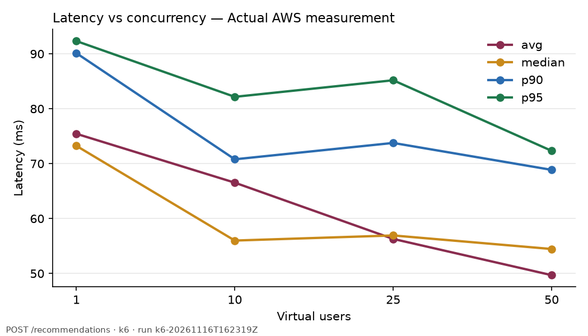

# 7. Testing and experiments

> Owner: Member 3 (experiments) and Member 2 (backend tests) · Diagram: [testing_workflow.mmd](diagrams/testing_workflow.mmd)

## 7.1 Automated tests

Run everything with `bash scripts/run_tests.sh`. The latest actual results are in [test_reports/validation_summary.md](../test_reports/validation_summary.md).

| File | Tests | What it covers |
|---|---:|---|
| `test_models.py` | 14 | Defaults, normalisation, extra fields, dataset validity and uniqueness, repository errors and caching |
| `test_validation.py` | 41 | Missing fields, invalid ages, wrong types (`"25"`, `true`, `25.5`), invalid age ranges, empty and duplicate interests, unknown education, 400-vs-422 classification |
| `test_recommendation.py` | 24 | Weights, score boundaries (0 and 100), each component, self-exclusion, inclusive age filter, strict city, sorting and tie-breaks, top-N, no matches, README example |
| `test_api.py` | 14 | Health, response structure, status codes 200/400/404/405/422, request-ID propagation, CORS preflight |
| `test_handler.py` | 8 | API Gateway v2 events through the real Lambda handler, base64 bodies, first-invocation flag, structured log fields |
| `test_edge_cases.py` | 9 | 500 without leaking details, 503 when data is missing, env-configured data path, unicode, null preferences, oversized bodies |
| **Total** | **110** | 99% line coverage of `backend/src` |

## 7.2 Experiment definitions

| Term | Meaning in this project |
|---|---|
| **Virtual user (VU)** | A simulated client looping *request → wait for response → think 1 s* (closed loop) |
| **Latency** | Client-measured time from sending the request to receiving the full response |
| **p90 / p95** | 90% / 95% of requests finished at or below this time |
| **Throughput** | Completed requests per second over the scenario |

Scenarios (`experiments/configs/scenarios.json`, `experiments/k6/scenarios.js`): **1, 10, 25 and 50 VUs, 30 s each**, endpoint `POST /recommendations`, three rotating synthetic bodies.
With 1 s of think time, the maximum load is about VUs requests/s (≤ 50 rps). That fits within the API throttle and keeps AWS usage tiny.

## 7.3 Result labels (never mixed)

| Label | Meaning | File |
|---|---|---|
| `actual_local` | Measured on our laptop against uvicorn | `experiments/results/local_results.csv` |
| `actual_aws` | Measured against the deployed API | `experiments/results/cloud_results.csv` (created by `collect_results.py`) |
| `pending_cloud` | Placeholder: not yet measured | `experiments/results/cloud_results_template.csv`, `cold_start_template.csv` |
| `illustrative` | Teaching example only | not used in results |

## 7.4 Actual local measurement (2026-11-13)

Environment: MacBook (Darwin arm64), Python 3.14, uvicorn with 1 worker, client `run_local_benchmark.py` (httpx threads, because k6 was not installed on that machine). Run `20261113T161410Z-494296`.

| VUs | Requests | Errors | Req/s | Avg ms | Min ms | Median ms | p90 ms | p95 ms | Max ms |
|---:|---:|---:|---:|---:|---:|---:|---:|---:|---:|
| 1 | 30 | 0% | 0.99 | 5.43 | 1.18 | 5.91 | 6.54 | 6.66 | 6.75 |
| 10 | 300 | 0% | 9.85 | 10.68 | 2.48 | 10.53 | 16.48 | 18.37 | 20.85 |
| 25 | 750 | 0% | 24.35 | 15.63 | 1.47 | 16.94 | 22.91 | 25.37 | 42.82 |
| 50 | 1500 | 0% | 48.43 | 20.89 | 1.62 | 20.33 | 35.19 | 37.16 | 45.72 |

### 7.4b Actual local measurement with k6 (2026-11-16)

Same scenarios and API code, but with **k6 v2.4.0** as the client (the tool we will also use on AWS). Run `k6-20261116T105354Z`, MacBook (Darwin arm64), uvicorn with 1 worker. Raw k6 summaries are in `experiments/results/raw/k6_local_*.json`; the table is in [`local_k6_summary.md`](../experiments/results/local_k6_summary.md).

| VUs | Requests | Errors | Req/s | Avg ms | Min ms | Median ms | p90 ms | p95 ms | Max ms |
|---:|---:|---:|---:|---:|---:|---:|---:|---:|---:|
| 1 | 30 | 0% | 0.99 | 4.62 | 1.87 | 4.72 | 5.13 | 5.17 | 5.51 |
| 10 | 300 | 0% | 9.84 | 16.14 | 9.93 | 16.12 | 18.50 | 19.31 | 25.73 |
| 25 | 750 | 0% | 24.27 | 29.07 | 2.21 | 29.81 | 32.96 | 34.42 | 41.63 |
| 50 | 1468 | 0% | 47.35 | 31.42 | 1.85 | 35.92 | 46.09 | 48.85 | 53.52 |

**Comparison with the Python-client run (7.4):** both runs show 0 errors, throughput matching the offered load, and latency rising with concurrency, because one local process queues the requests. The k6 numbers are higher at 10–50 VUs (p95 at 50 VUs: 48.9 ms vs 37.2 ms). The two runs used different client tools on different days, so this gap reflects differences between tools and between runs, not a change in the API. Use **k6 rows only** when comparing against AWS, so the client tool is the same on both sides.

**How to read it:** a single local process serves every VU, so requests queue up and latency grows with concurrency (median 5.9 → 20.3 ms). Throughput tracks the offered load (about VUs × 1 rps), with no errors. These numbers have **no network hop to AWS and no Lambda**. They show that the application code is fast, and they **must not** be presented as cloud performance.

**Hypothesis for AWS (to test, not a result):** latency will include tens of milliseconds of network time to the region, plus API Gateway overhead. Under load, Lambda should add execution environments instead of queueing, so p95 should grow less with VUs than it did locally. That holds except for occasional cold starts, which should appear as max/p99 outliers.

## 7.5 AWS experiment procedure

1. Deploy (doc 06). Record region, memory and architecture.
2. `API_URL=… bash experiments/run_aws_experiments.sh` runs the 4 scenarios, imports rows as `actual_aws`, then analyses and charts them.
3. **Cold starts:**
   - (a) Deploy a fresh version or wait ≥ 15–20 minutes with no traffic. Then send 1 request, followed by 10 requests 1 s apart. Record the first and later durations.
   - (b) Run the Logs Insights queries in `experiments/cloudwatch/cold_start_queries.md` to count `Init Duration` lines and `first_invocation_in_env=true`.
   - (c) Fill `experiments/results/cold_start_template.csv` → `cold_start_results.csv` with label `actual_aws`.
4. **Billed duration** → average of `@billedDuration` → `cost_inputs.json` → `cost_model.py`.
5. Compare local and AWS **in text**. Keep them as separate tables and charts.

## 7.5b Actual AWS measurement (2026-11-16)

**Deployment:** stack `shaadi-recommendation-dev`, ap-south-1 (Mumbai), Lambda python3.12, 512 MB, x86_64, API Gateway HTTP API (throttle 50 rps / burst 100).
**Client:** k6 v2.4.0 on a MacBook (Darwin arm64) in India, over the public internet. Each scenario ran 30 s with 1 s think time, against `POST /recommendations`.
**Files:** `experiments/results/cloud_results.csv`, [`cloud_summary.md`](../experiments/results/cloud_summary.md), `raw/k6_aws_*.json`, `cold_start_results.csv`, `raw/cold_probe_aws_20261116.json`.

### Functional check on AWS

| Check | Result |
|---|---|
| `GET /health` | 200, `environment: dev`, 64 profiles |
| README example request | 200, top results U161 = 97, U162 = 80, U133 = 62 (identical to local) |
| Invalid JSON / missing body / age 12 / no matches | 400 / 400 / 422 / 200 with message ✅ |
| Unknown path | 404 `{"message":"Not Found"}` from API Gateway (only our 2 routes are forwarded to Lambda) |
| CORS preflight from `http://localhost:5500` | 204, `access-control-allow-origin: *` ✅ |
| Frontend (headless Chrome) against the AWS URL | All flows pass. Screenshots in `reports/figures/frontend_*_aws.png` |

### Latency and concurrency (run `k6-20261116T162319Z`)

| VUs | Requests | Errors | Req/s | Avg ms | Min ms | Median ms | p90 ms | p95 ms | Max ms |
|---:|---:|---:|---:|---:|---:|---:|---:|---:|---:|
| 1 | 26 | 0% | 0.85 | 75.44 | 63.99 | 73.25 | 90.13 | 92.33 | 110.87 |
| 10 | 283 | 0% | 9.12 | 66.54 | 27.84 | 56.00 | 70.79 | 82.17 | 1466.40 |
| 25 | 563 | 0% | 18.18 | 56.30 | 28.04 | 56.93 | 73.77 | 85.19 | 440.86 |
| 50 | 1446 | **5.50%** | 46.55 | 49.70 | 22.06 | 54.46 | 68.87 | 72.33 | 322.35 |

**Local (k6, 7.4b) vs AWS (k6), p95:**

| VUs | Local p95 ms | AWS p95 ms |
|---:|---:|---:|
| 1 | 5.17 | 92.33 |
| 10 | 19.31 | 82.17 |
| 25 | 34.42 | 85.19 |
| 50 | 48.85 | 72.33 |

**Interpretation**
1. **The network dominates single-request latency.** The application itself needs about 2.5 ms per request on AWS (`X-Response-Time-Ms`). The rest of the roughly 50–75 ms is the internet round trip, TLS, API Gateway and Lambda invocation overhead.
2. **AWS latency does not grow with concurrency, unlike local.** Local p95 rises about 9× from 1 to 50 VUs, because one uvicorn process queues the requests. On AWS, p95 stays at about 72–92 ms, because Lambda serves concurrent requests in separate execution environments. This is the elasticity property of serverless, observed directly.
3. **Scale-out cold starts show up in the maximum, not the percentiles.** The 1,466 ms maximum at 10 VUs fits a new execution environment being initialised during scale-up (CloudWatch `Init Duration` is about 1.1 s per cold start, see below). p95 is unaffected because such requests are rare.
4. **Errors at 50 VUs are HTTP 503s, not API Gateway throttling (429).** A follow-up burst test (3 rounds of 50 simultaneous requests) returned 503 `{"message":"Service Unavailable"}` for 16 → 2 → 0 requests as the environments warmed up. A 503 from an HTTP API Lambda integration usually means Lambda throttled the invocation. **What the API Gateway access logs and REPORT lines show** (CloudWatch export, 16:21:55–16:42 UTC):
   - the 503s are bunched in the **first ~10 s** of the 50-VU stage (5, 10, 4, 4, 1, 3, 4 … per second), then almost stop (2 in the last 20 s), and again in the first burst (16 at 16:22:56, 2 at 16:22:57);
   - each 503 came back with an integration latency of only **3–9 ms**, and there is **no matching Lambda REPORT line** for them (1,421 REPORT lines vs 1,419 HTTP 200s in the same window), so Lambda rejected them **before** running our code;
   - only about **8 execution environments** were active at the peak (from the `invocation_number_in_env` counters in our JSON logs).

   So the errors happen while Lambda is scaling out, and stop once enough environments exist. Being rejected at about 8 environments fits the **hypothesis** that the account's concurrent-execution quota is low (new accounts often start at 10 instead of 1,000). This is **still not verified**: the Lambda `Throttles` metric and `aws lambda get-account-settings` were not collected. Failed requests return quickly, which slightly lowers the 50-VU latency figures.
5. Fewer requests than the ideal VUs × 30 were completed at 25 VUs (563 vs about 710). The cause is not yet explained; check the CloudWatch metrics for that window.

### Cold start: client-side view (`cold_start_results.csv`)

| Request | Client latency | App time (server) |
|---|---:|---:|
| 1st request after an idle period | **1,722.96 ms** | 3.79 ms |
| Next 10 requests, 1 s apart | 43.7–64.6 ms (mean 51.5 ms) | 2.3–4.0 ms |

The first request was about **33× slower** than the warm ones, while the application code itself took under 4 ms in both cases. So the extra time is spent before our handler runs: creating the execution environment, starting Python, importing FastAPI/Pydantic and loading the dataset. Part of the first request's time is also a new HTTPS connection (DNS + TLS). **CloudWatch separates the Lambda part** (table below). A one-off 6.3 s browser health check during the frontend test is *not* reported as a measurement; check it against CloudWatch.

### Cold start: Lambda view (CloudWatch REPORT lines, *actual AWS measurement*)

| Invocation | Init Duration | Duration | Billed Duration | Max memory |
|---|---:|---:|---:|---:|
| Cold probe, 1st request (16:18:38 UTC) | **1,115.71 ms** | 262.48 ms | 1,379 ms | 85 MB |
| Cold probe, next 10 requests | — | 4.65–16.38 ms | 5–17 ms | 85 MB |
| Later cold start after idle (16:42:17 UTC) | **1,101.47 ms** | 249.04 ms | 1,351 ms | 85 MB |

Of the 1,723 ms the client saw for the first request, about **1,378 ms** was Lambda (1,116 ms init + 262 ms first invocation). The rest, about 345 ms, is the new HTTPS connection plus API Gateway. Our own `lambda_init` log puts module import and dataset load at 1,022 ms, so most of `Init Duration` is our Python imports, not the platform. The first invocation (262 ms) is also slower than warm ones (about 5 ms), because Python's first-call costs (lazy imports, Pydantic schema building) come on top. **Billed duration includes init** for this ZIP-packaged Python function, which is why the cold request is billed 1,379 ms. Memory use is 85 MB of 512 MB.

**Billed duration over all 2,398 invocations** (Logs Insights, `experiments/results/raw/cloudwatch_billed_duration_20261116.csv`): average **12.593 ms**, p50 5 ms, p95 14 ms (average duration 7.36 ms). The average is pulled up by the few cold starts. In the raw sample (1,421 invocations), the warm average is 6.74 ms. These figures feed the cost model in doc 08.

**Still not collected:** the total number of cold starts during the k6 run (the raw export hit the 10,000-row limit and starts at 16:21:55), the Lambda `Throttles` metric, and the account concurrency quota.

## 7.6 Cold starts explained

- **What:** the extra delay when Lambda must create a new **execution environment** before it can run our handler.
- **Why it happens:** there is no warm environment for that function version. Causes include the first request after a deploy, traffic after an idle period, or a burst needing more parallel environments than exist.
- **Phases:** download the code package → start the runtime (Python) → run module-level code (*Init*: import FastAPI and Pydantic, load the dataset) → then invoke the handler.
- **Warm invocation:** the environment is reused, so only the handler runs. Module-level objects (the app, the cached dataset) are already in memory.
- **How we observe it:**
  - Lambda prints `Init Duration: X ms` in the `REPORT` log line **only for cold starts**.
  - Our handler logs `first_invocation_in_env: true` and `module_init_ms` on the first invocation in each environment.
  - API Gateway access logs show `integrationLatency` for the same request IDs.
- **Not a cold start:** the first request to local uvicorn, `pytest`, or `sam local`. These run the same code but not on Lambda's infrastructure.
- **Mitigations (discussion):** smaller packages and fewer imports, more memory (more CPU), provisioned concurrency (costs money), SnapStart (if supported for the runtime), keeping latency-sensitive paths warm.
